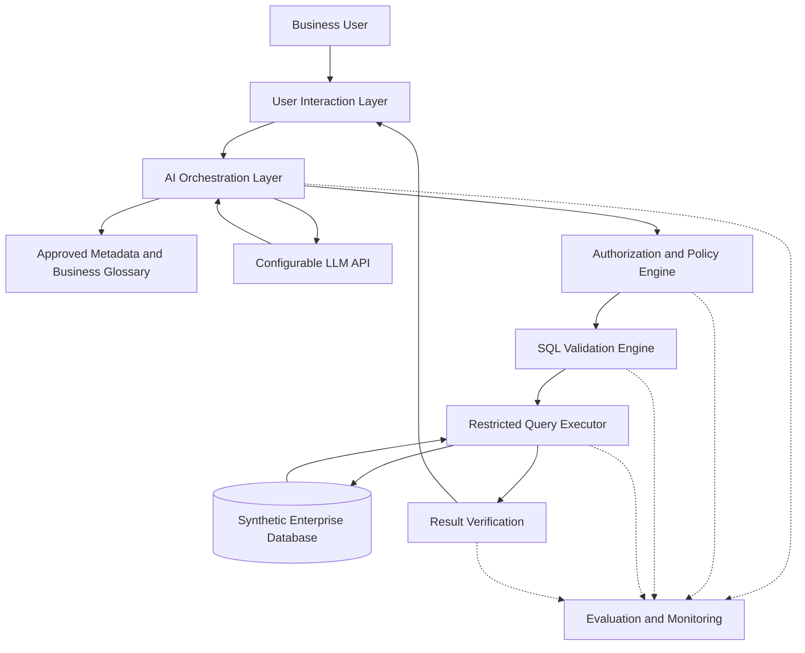
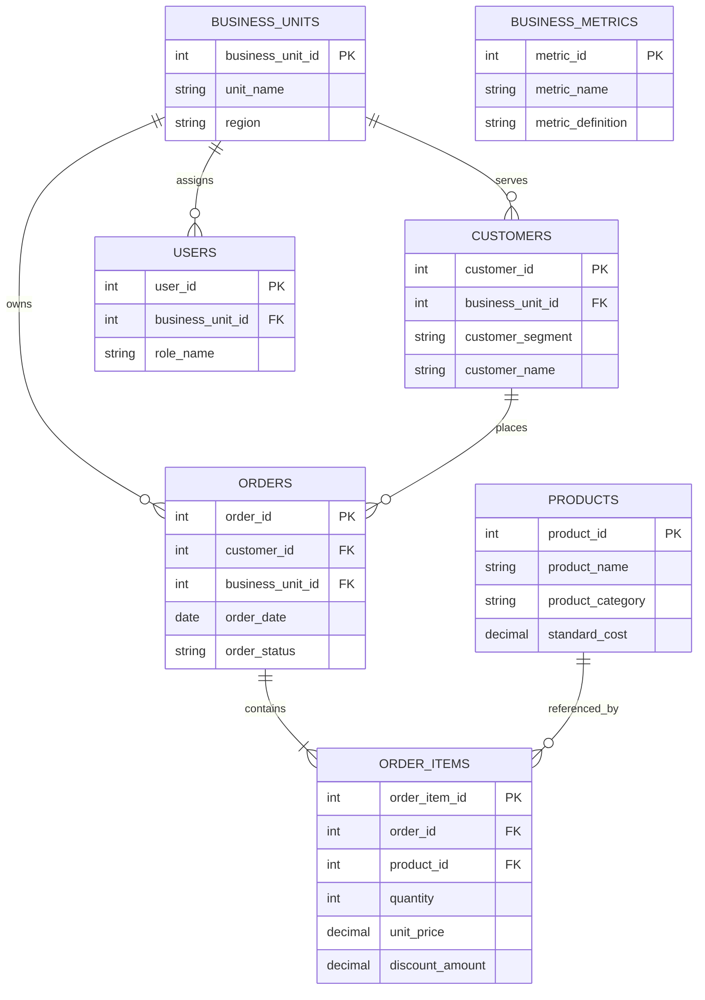
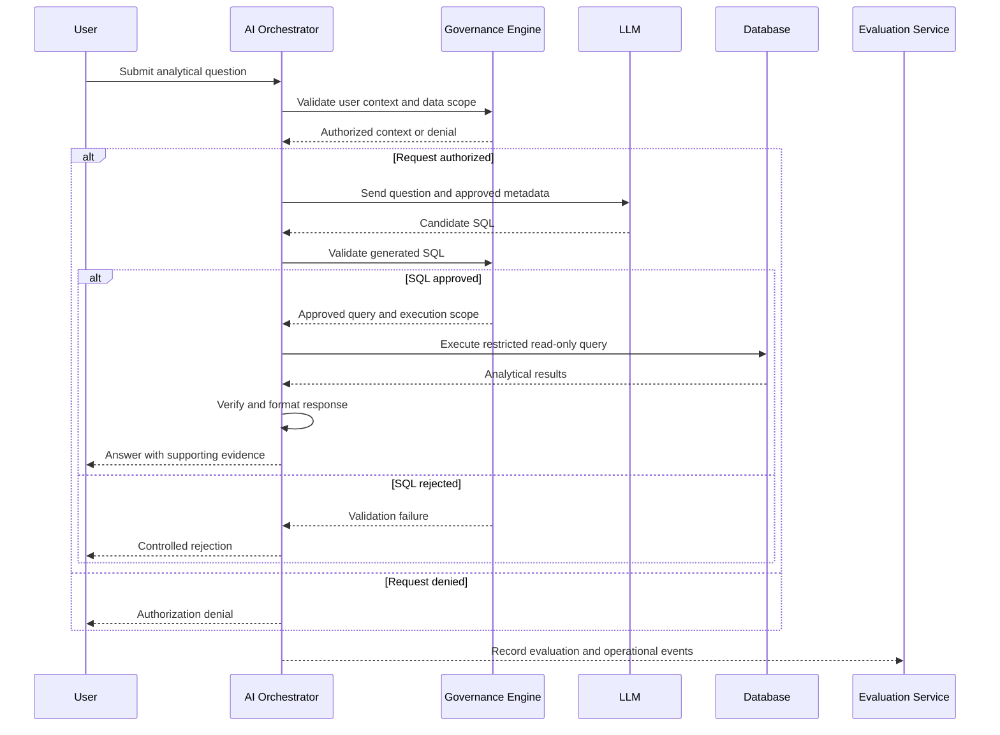

# Enterprise AI Governance & Evaluation
## System Architecture

**Version:** 1.0  
**Date:** October 24, 2026  
**Status:** Draft — Milestone 1  
**Business Domain:** Enterprise Sales and Operations  
**Related Documents:** [Project Charter](project-charter.md) | [System Requirements](requirements.md)

---

## 1. Purpose

This document defines the proposed logical and technical architecture for the Enterprise AI Governance & Evaluation system.

The architecture establishes the components, interfaces, data flows, trust boundaries, and design decisions required to support governed AI-generated analytics using synthetic enterprise sales and operations data.

The design emphasizes security, data governance, analytical correctness, traceability, and measurable evaluation.

The system is intended as a reproducible proof of concept rather than a production-certified enterprise application.

## 2. Architectural Objectives

The architecture will support the following objectives:

1. Provide a natural-language interface for analytical business questions.
2. Separate AI-generated analytical logic from authorization and execution controls.
3. Establish approved enterprise data definitions and metadata.
4. Enforce least-privilege access to authorized analytical data.
5. Validate generated SQL before execution.
6. Produce analytical responses supported by verifiable evidence.
7. Capture operational, governance, and evaluation metrics.
8. Support repeatable comparisons across three AI configurations.
9. Maintain modular components that can be independently tested and extended.

## 3. Architectural Principles

| Principle | Description |
|---|---|
| Separation of Concerns | AI orchestration, governance, execution, and evaluation will have distinct responsibilities. |
| Least Privilege | Users and system components will receive only the permissions required for authorized operations. |
| Defense in Depth | Authorization, SQL validation, restricted execution, and output controls will provide multiple safeguards. |
| Data Governance by Design | Business definitions, classifications, and access policies will be integrated into the analytical workflow. |
| Explainability and Traceability | Analytical results will retain sufficient evidence to support independent verification. |
| Reproducibility | Data generation, configuration, and evaluation procedures will be documented and version controlled. |
| Modularity | Components will use defined interfaces to support testing and future technology changes. |
| Fail-Secure Behavior | Authorization or validation failures will prevent execution of the affected operation. |

## 4. Logical Architecture

The system will consist of five primary logical layers.

### 4.1 User Interaction Layer

Accepts analytical questions and presents responses.

Responsibilities:

- Receive natural-language questions.
- Associate requests with trusted user identity and role information.
- Present analytical results, clarification requests, or denial messages.
- Display supporting analytical evidence where authorized.

### 4.2 AI Orchestration Layer

Coordinates interpretation and generation of analytical queries.

Responsibilities:

- Construct analytical requests using approved context.
- Retrieve relevant schema information and business metadata.
- Invoke a configurable LLM.
- Generate candidate SQL queries.
- Coordinate analytical response generation.
- Record model configuration and usage metadata.

The LLM will not be treated as an authoritative source of access permissions or business metric definitions.

### 4.3 Governance and Policy Layer

Provides independent authorization, metadata governance, and query validation.

Responsibilities:

- Determine authorized data scope.
- Apply role-based access policies.
- Retrieve approved business definitions.
- Validate SQL structure and permitted database objects.
- Enforce query execution restrictions.
- Reject unauthorized or unsafe requests.
- Record policy decisions.

Governance controls will operate independently of LLM-generated instructions.

### 4.4 Enterprise Data Layer

Provides controlled access to synthetic enterprise data.

Responsibilities:

- Store relational sales and operations data.
- Maintain defined data relationships.
- Support approved analytical queries.
- Enforce read-only execution permissions.
- Provide restricted views or equivalent controlled access mechanisms.
- Maintain reproducible synthetic data generation procedures.

### 4.5 Evaluation and Monitoring Layer

Measures analytical correctness, security compliance, reliability, latency, and cost.

Responsibilities:

- Execute predefined benchmark questions.
- Compare analytical results with reference answers.
- Record authorization and validation outcomes.
- Capture response latency and model usage.
- Compare experimental configurations.
- Generate evaluation summaries and visualizations.

Monitoring will capture events across the analytical workflow rather than operate solely after query execution.

## 5. High-Level Architecture Diagram

The following Mermaid diagram represents the proposed logical component relationships.



The diagram represents logical responsibilities. Actual implementation may combine components into Python modules while preserving their interfaces and security boundaries.

Authorization and SQL validation will be enforced by trusted application code. The database connection used for query execution will have restricted permissions.

## 6. Component Responsibilities

| Component | Primary Responsibility | Proposed Implementation |
|---|---|---|
| User Interface | Receive questions and display results | Python CLI initially |
| AI Orchestrator | Coordinate analytical processing | Python |
| LLM Adapter | Communicate with configured model provider | Provider-specific Python adapter |
| Metadata Service | Provide approved schema and business context | Versioned metadata files |
| Policy Engine | Evaluate role and data-access permissions | Python policy module |
| SQL Validator | Validate query structure and permitted operations | SQL parser and policy checks |
| Query Executor | Execute authorized read-only queries | SQLite restricted connection |
| Enterprise Database | Store synthetic relational data | SQLite |
| Result Verifier | Check results and supporting evidence | Python validation module |
| Evaluation Engine | Execute benchmarks and score outcomes | Python and pytest |
| Monitoring Service | Record operational and evaluation events | Structured logs and result files |

## 7. Enterprise Data Architecture

The initial data model will represent a synthetic enterprise sales and operations environment.

### 7.1 Proposed Entities

| Entity | Primary Key | Purpose |
|---|---|---|
| Customers | customer_id | Customer information and segmentation |
| Orders | order_id | Sales transactions and order status |
| Order Items | order_item_id | Products, quantities, prices, and discounts |
| Products | product_id | Product catalog and categories |
| Business Units | business_unit_id | Organizational ownership and reporting boundaries |
| Users | user_id | Simulated system users and assigned roles |
| Business Metrics | metric_id | Approved analytical definitions and calculation rules |

A separate role-permission configuration will define access policies. It may be implemented through relational tables or version-controlled configuration files.

### 7.2 Logical Entity Relationships



Business Metrics is a metadata entity rather than a transactional entity. Its definitions will reference approved analytical fields and calculations.

The initial diagram assumes one primary business unit per user. Support for multiple authorized business units will be represented through a separate authorization mapping if required.

### 7.3 Data Classification

| Classification | Description | Example |
|---|---|---|
| Public | Non-sensitive information suitable for broad use | Synthetic product categories |
| Internal | General operational information | Aggregated synthetic sales |
| Confidential | Restricted business information | Customer-level transaction records |
| Restricted | Information requiring explicit authorization | Simulated sensitive financial or customer attributes |

All records will be synthetic. Classification labels will be used to demonstrate enterprise access policies rather than imply the presence of real sensitive information.

## 8. Analytical Processing Workflow

The system will process analytical requests through the following sequence.

1. Receive the analytical question and trusted user context.
2. Determine the user's authorized data scope.
3. Retrieve approved schema and business metadata appropriate to the selected configuration.
4. Construct the LLM request using authorized context.
5. Generate candidate SQL.
6. Validate SQL structure, referenced objects, and authorization requirements.
7. Execute approved SQL using a restricted database connection.
8. Verify result structure and applicable business calculations.
9. Generate an analytical response supported by authorized evidence.
10. Record request, security, performance, and evaluation metadata.

Requests that fail authorization or validation will not proceed to unrestricted query execution.

### 8.1 Processing Sequence



The evaluation service receives structured event records. Its availability will not determine whether unauthorized queries are permitted.

## 9. Security Architecture

### 9.1 Trust Boundaries

The architecture defines four principal trust boundaries.

| Boundary | Description | Required Control |
|---|---|---|
| TB-01 | User to Application | Trusted identity context and input validation |
| TB-02 | Application to LLM Provider | Approved context, minimized data disclosure, and controlled API access |
| TB-03 | LLM Output to Query Execution | Independent SQL validation and authorization |
| TB-04 | Application to Database | Restricted database connection and controlled data access |

The LLM will be treated as an untrusted query-generation component. It will not receive direct database credentials or unrestricted execution capabilities.

### 9.2 Security Controls

The system will implement:

- Role-based authorization using trusted user context.
- Approved database object and column access.
- Row-level business-unit restrictions enforced through trusted query construction or restricted views.
- Read-only database connections.
- SQL parsing and structural validation.
- Query execution limits.
- Denial of unsupported or unsafe operations.
- Structured security-event logging.
- Protection of API credentials through environment configuration.

For the SQLite proof of concept, row-level restrictions will be enforced by the application and controlled query interface. SQLite will not be represented as providing native enterprise row-level security.

### 9.3 Prompt Injection Considerations

The architecture will treat user-provided text, retrieved data, and LLM output as untrusted inputs.

Instructions embedded in data or generated responses will not be permitted to alter authorization policies, enable prohibited operations, or expand database access.

Security testing will include attempts to bypass business-unit restrictions, request unauthorized columns, and manipulate query-generation behavior.

## 10. Experimental Architecture

The system will support three configurations for comparative evaluation.

### Configuration A — Baseline

- Approved schema context
- Natural-language question processing
- LLM-generated SQL
- Common minimum execution safeguards

### Configuration B — Metadata-Enriched

Includes Configuration A capabilities plus:

- Approved business glossary
- Metric calculation definitions
- Data relationship descriptions
- Business terminology guidance

### Configuration C — Governed

Includes Configuration B capabilities plus:

- Explicit policy evaluation
- Enhanced SQL authorization and validation
- Controlled analytical execution
- Result verification
- Detailed governance decision logging

All configurations will retain essential execution restrictions. Comparative findings will distinguish analytical improvements from security-control outcomes.

## 11. Evaluation and Monitoring Architecture

The evaluation framework will execute a predefined benchmark of 50 analytical and governance test cases.

### 11.1 Evaluation Categories

| Category | Test Cases |
|---|---:|
| Basic Analytical Queries | 10 |
| Business Definition Questions | 10 |
| Complex Analytical Questions | 10 |
| Authorization and Policy Tests | 10 |
| Ambiguous or Unsupported Requests | 10 |
| **Total** | **50** |

### 11.2 Evaluation Metrics

| Metric | Measurement |
|---|---|
| Analytical Accuracy | Correct supported analytical responses divided by total supported analytical test attempts |
| Authorization Compliance | Correctly enforced authorization decisions and unauthorized disclosures |
| Reliability | Successfully completed authorized requests divided by total authorized supported attempts |
| Latency | Median and 95th-percentile end-to-end response time |
| Cost | Estimated model cost per request and per correct analytical response |
| Traceability | Percentage of evaluated requests linked to configuration and benchmark case |
| Reproducibility | Ability to recreate data, configurations, and evaluation results |

Evaluation records will contain configuration identifiers, model settings, benchmark identifiers, expected outcomes, actual outcomes, timestamps, and available usage metrics.

Raw prompts and analytical results will be logged only when appropriate for the synthetic environment and evaluation requirements.

## 12. Proposed Implementation Architecture

The initial solution will use a modular Python implementation.

```text
src/
├── agent/
│   ├── orchestrator.py
│   ├── llm_adapter.py
│   └── response_builder.py
├── governance/
│   ├── authorization.py
│   ├── sql_validator.py
│   ├── metadata_service.py
│   └── policy_engine.py
├── data/
│   ├── database.py
│   ├── query_executor.py
│   └── synthetic_data.py
├── evaluation/
│   ├── benchmark_runner.py
│   ├── metrics.py
│   └── result_validator.py
└── monitoring/
    ├── audit_logger.py
    └── usage_tracker.py
```

The proposed structure separates AI orchestration, governance, data access, evaluation, and monitoring.

Additional configuration and test directories will be established during implementation.

## 13. Deployment Architecture

The initial proof of concept will run in a local development environment.

### 13.1 Initial Environment

| Component | Deployment |
|---|---|
| Application | Local Python runtime |
| Database | Local SQLite database |
| LLM | External API or configurable compatible provider |
| Metadata | Local version-controlled files |
| Evaluation | Local automated test runner |
| Logs and Results | Local structured files |
| Source Control | GitHub |

### 13.2 Future Enterprise Considerations

Potential enterprise extensions include:

- Containerized deployment
- Managed relational database services
- Enterprise identity and access management
- Centralized secrets management
- Centralized audit logging and observability
- API gateway and service authentication
- CI/CD security and quality controls
- Scalable evaluation and monitoring infrastructure

These extensions are outside the initial implementation scope.

## 14. Architectural Decisions

The following decisions establish the initial architecture baseline.

| ID | Decision | Rationale |
|---|---|---|
| ADR-001 | Use a modular Python architecture | Supports component separation, testing, and maintainability |
| ADR-002 | Use SQLite for the initial database | Reduces infrastructure complexity while supporting relational analytics |
| ADR-003 | Use synthetic enterprise data | Enables reproducible testing without exposing organizational information |
| ADR-004 | Separate LLM generation from query execution | Prevents model output from directly controlling database operations |
| ADR-005 | Enforce authorization outside the LLM | Establishes a trusted policy enforcement boundary |
| ADR-006 | Maintain approved business definitions independently | Supports consistent analytical calculations |
| ADR-007 | Compare three configurations | Enables controlled evaluation of metadata and governance effects |
| ADR-008 | Use predefined benchmark questions | Supports objective and repeatable evaluation |
| ADR-009 | Maintain common minimum security controls | Prevents unsafe experimental configurations |
| ADR-010 | Use version-controlled Markdown documentation | Supports transparency, traceability, and portfolio review |

These decisions may be refined through documented architecture reviews.

## 15. Requirements Traceability

| Architecture Component | Related Requirements |
|---|---|
| User Interaction Layer | FR-01, FR-07 |
| AI Orchestration Layer | FR-02, FR-03, FR-10 |
| Governance and Policy Layer | FR-04, FR-05, GSR-01–GSR-10 |
| Enterprise Data Layer | FR-06, DR-01–DR-07 |
| Evaluation and Monitoring Layer | FR-08, FR-09, FR-11, ER-01–ER-08 |
| Security Architecture | NFR-01, NFR-07, GSR-01–GSR-10 |
| Performance and Reliability | NFR-03, NFR-04, NFR-08 |
| Reproducibility | NFR-05, NFR-06, DR-06 |

## 16. Architecture Verification Criteria

The Milestone 1 architecture review will verify that:

1. All five logical architecture layers are documented.
2. Component responsibilities and primary interfaces are defined.
3. The proposed data model includes all seven primary entities.
4. Primary data relationships and classifications are identified.
5. Authorization and SQL validation occur independently of the LLM.
6. Trust boundaries and corresponding security controls are documented.
7. Analytical processing and failure paths are represented.
8. All three experimental configurations are defined.
9. Evaluation and monitoring responsibilities are established.
10. Major architectural decisions are documented and traceable to requirements.

Verification at this milestone confirms design completeness, not implementation correctness or production readiness.

## 17. Known Limitations and Open Design Items

The initial architecture has the following limitations and unresolved design details:

- SQLite does not provide native enterprise row-level security.
- The exact LLM provider and model version have not been selected.
- The SQL parser and validation implementation require technical evaluation.
- The business glossary and access-control matrix remain to be finalized.
- The synthetic data volume and distribution have not been established.
- The 50 benchmark cases have not yet been implemented.
- Enterprise authentication and production deployment are excluded.
- Security and performance targets remain unverified until implementation.

These items will be tracked through requirements, governance documentation, and subsequent milestones.

## 18. References

National Institute of Standards and Technology. (2023). *Artificial intelligence risk management framework (AI RMF 1.0).* https://doi.org/10.6028/NIST.AI.100-1

National Institute of Standards and Technology. (2024). *Artificial intelligence risk management framework: Generative artificial intelligence profile (NIST AI 600-1).* https://doi.org/10.6028/NIST.AI.600-1

OWASP Foundation. (n.d.). *OWASP Top 10 for large language model applications.* https://genai.owasp.org/llm-top-10/

---

**Document Status:** Draft — Milestone 1
