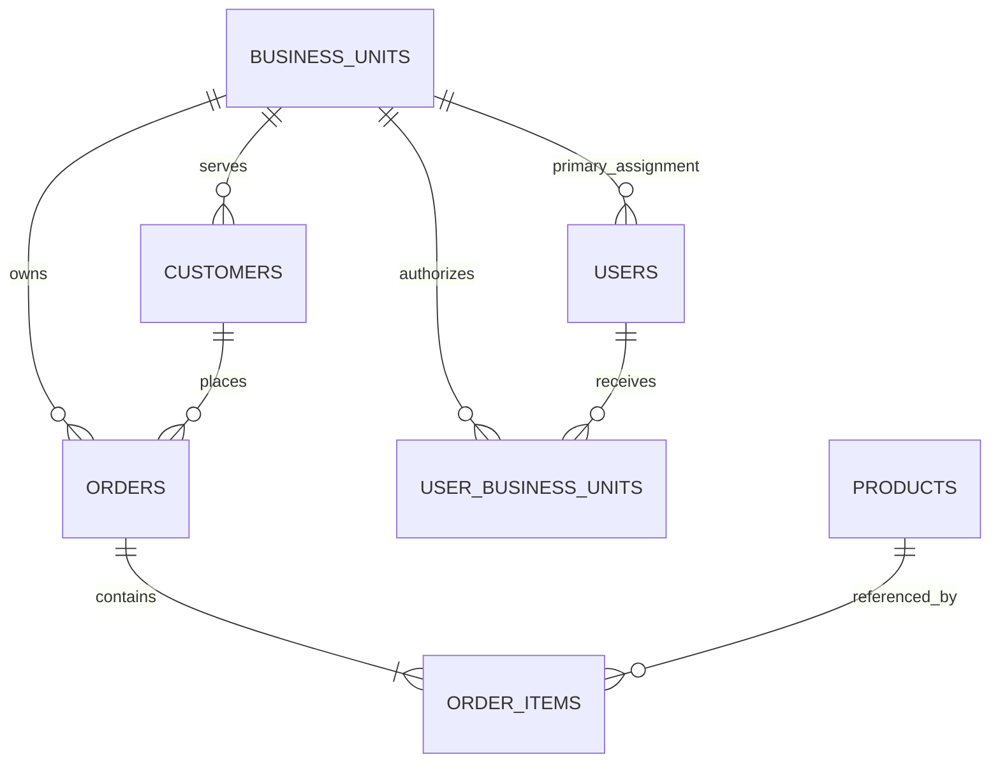

# Enterprise AI Governance & Evaluation
## Data Dictionary and Physical Data Model

**Version:** 0.1  
**Date:** October 24, 2026  
**Status:** Draft — Milestone 2  
**Milestone:** M2 — Data and Governance Foundation

**Related Documents:** [System Requirements](requirements.md) | [System Architecture](architecture.md) | [Governance Framework](governance-framework.md) | [Evaluation Plan](evaluation-plan.md) | [Milestone 1 Review](milestone-1-review.md)

---

## 1. Purpose and Scope

This document translates the approved Milestone 1 logical architecture into a proposed SQLite physical data model for a reproducible, synthetic enterprise sales and operations dataset. It specifies entities, attributes, keys, relationships, data classifications, validation rules, and authorization boundaries. It is a design specification, not evidence of implemented controls or verified data.

The seven original business/metadata entities are retained. `USER_BUSINESS_UNITS` is an additional technical authorization association to address DI-03.

## 2. Entity Inventory

| Entity | Primary Key | Purpose | Default Classification |
|---|---|---|---|
| `BUSINESS_UNITS` | `business_unit_id` | Organizational reporting and access boundaries | Internal |
| `CUSTOMERS` | `customer_id` | Synthetic customers and segments | Confidential |
| `ORDERS` | `order_id` | Sales transactions and status | Confidential |
| `ORDER_ITEMS` | `order_item_id` | Transaction line items and prices | Confidential |
| `PRODUCTS` | `product_id` | Product catalog and standard costs | Internal |
| `USERS` | `user_id` | Simulated identities and roles | Restricted |
| `BUSINESS_METRICS` | `metric_id` | Approved metric definitions | Internal |
| `USER_BUSINESS_UNITS` | (`user_id`, `business_unit_id`) | Explicit authorized unit scopes | Restricted |

`BUSINESS_METRICS` is metadata and does not directly join to transactions. The minimum-one-order-line constraint needs a cross-table validation test.

## 3. Physical Design Standards

- Table names: uppercase plural; column names: lowercase `snake_case`.
- Identifiers: `INTEGER`; strings: `TEXT`; dates: ISO 8601 `YYYY-MM-DD` text; timestamps: UTC ISO 8601 text.
- Boolean values: `INTEGER` constrained to 0 or 1.
- USD monetary amounts: **integer cents**, not floating-point currency.
- Primary keys are unique and non-null; required fields use `NOT NULL`.
- Enable `PRAGMA foreign_keys = ON` for every SQLite connection.
- Validate dates, cross-table rules, and authorization outside SQLite where necessary.
- All identities and transactions must be synthetic.

**Classification levels:** Public (shareable synthetic reference), Internal (ordinary operational), Confidential (controlled customer/transaction data), Restricted (explicit permission required). Derived results inherit applicable restrictions unless an approved policy permits release.

## 4. BUSINESS_UNITS

**Primary key:** `business_unit_id` · **Classification:** Internal

| Column | Type | Required | Classification | Definition / Constraint |
|---|---|---|---|---|
| `business_unit_id` | INTEGER | Yes | Internal | Primary key |
| `unit_code` | TEXT | Yes | Internal | Unique stable code |
| `unit_name` | TEXT | Yes | Internal | Display name |
| `region` | TEXT | Yes | Internal | Reporting region |
| `is_active` | INTEGER | Yes | Internal | Boolean 0/1 |

Inactive units may retain historical orders. Unit activity does not independently grant or revoke access.

## 5. CUSTOMERS

**Primary key:** `customer_id` · **Foreign key:** `business_unit_id → BUSINESS_UNITS` · **Classification:** Confidential

| Column | Type | Required | Classification | Definition / Constraint |
|---|---|---|---|---|
| `customer_id` | INTEGER | Yes | Confidential | Primary key |
| `business_unit_id` | INTEGER | Yes | Confidential | Owning unit |
| `customer_code` | TEXT | Yes | Confidential | Unique synthetic code |
| `customer_name` | TEXT | Yes | Confidential | Fictional name |
| `customer_segment` | TEXT | Yes | Internal | Controlled segment vocabulary |
| `created_date` | TEXT | Yes | Internal | ISO date |
| `is_active` | INTEGER | Yes | Internal | Boolean 0/1 |

Each customer has one primary unit. In this initial model, the customer's business unit must match the business unit of every associated order.

## 6. ORDERS

**Primary key:** `order_id` · **Foreign keys:** `customer_id → CUSTOMERS`; `business_unit_id → BUSINESS_UNITS` · **Classification:** Confidential

| Column | Type | Required | Classification | Definition / Constraint |
|---|---|---|---|---|
| `order_id` | INTEGER | Yes | Confidential | Primary key |
| `order_number` | TEXT | Yes | Confidential | Unique order code |
| `customer_id` | INTEGER | Yes | Confidential | Customer reference |
| `business_unit_id` | INTEGER | Yes | Confidential | Owning unit |
| `order_date` | TEXT | Yes | Internal | ISO order date |
| `order_status` | TEXT | Yes | Internal | `PENDING`, `COMPLETED`, `CANCELED` |
| `completed_date` | TEXT | No | Internal | ISO completion date |
| `currency_code` | TEXT | Yes | Internal | Initially `USD` |

Every order must have at least one item. Completion cannot precede the order date. Revenue eligibility by order status will be specified in `business-metrics.md`.

## 7. ORDER_ITEMS

**Primary key:** `order_item_id` · **Foreign keys:** `order_id → ORDERS`; `product_id → PRODUCTS` · **Classification:** Confidential

| Column | Type | Required | Classification | Definition / Constraint |
|---|---|---|---|---|
| `order_item_id` | INTEGER | Yes | Confidential | Primary key |
| `order_id` | INTEGER | Yes | Confidential | Parent order |
| `line_number` | INTEGER | Yes | Internal | Positive; unique within order |
| `product_id` | INTEGER | Yes | Internal | Product reference |
| `quantity` | INTEGER | Yes | Confidential | Positive integer |
| `unit_price_cents` | INTEGER | Yes | Confidential | Nonnegative unit price |
| `discount_amount_cents` | INTEGER | Yes | Confidential | Nonnegative line discount |

Enforce `UNIQUE(order_id, line_number)`. Line gross = quantity × unit price; line net before status filtering = gross − discount. Discount must not exceed gross. Order totals are derived, not independently generated.

## 8. PRODUCTS

**Primary key:** `product_id` · **Default classification:** Internal

| Column | Type | Required | Classification | Definition / Constraint |
|---|---|---|---|---|
| `product_id` | INTEGER | Yes | Internal | Primary key |
| `product_code` | TEXT | Yes | Internal | Unique code |
| `product_name` | TEXT | Yes | Internal | Display name |
| `product_category` | TEXT | Yes | Public | Approved category |
| `standard_cost_cents` | INTEGER | Yes | Restricted | Nonnegative cost in cents |
| `is_active` | INTEGER | Yes | Internal | Boolean 0/1 |

Inactive products may appear in historical orders. Standard costs are available only under explicit Finance Analyst authorization; they must not be exposed to unauthorized SQL, LLM context, or logs. Historical cost changes are not modeled.

## 9. USERS

**Primary key:** `user_id` · **Foreign key:** nullable `business_unit_id → BUSINESS_UNITS` · **Classification:** Restricted

| Column | Type | Required | Classification | Definition / Constraint |
|---|---|---|---|---|
| `user_id` | INTEGER | Yes | Restricted | Primary key |
| `user_code` | TEXT | Yes | Restricted | Unique synthetic identity |
| `display_name` | TEXT | Yes | Restricted | Fictional name |
| `role_name` | TEXT | Yes | Restricted | Approved role |
| `business_unit_id` | INTEGER | No | Restricted | Primary assignment only |
| `is_active` | INTEGER | Yes | Restricted | Boolean 0/1 |

Approved roles: Sales Analyst, Operations Manager, Finance Analyst, Data Steward, System Administrator. Initial implementation assumes one role per user. The primary unit does **not** itself grant data access. Inactive users are denied. Data Stewards and System Administrators have no default transaction access.

## 10. USER_BUSINESS_UNITS

**Composite primary key:** (`user_id`, `business_unit_id`) · **Foreign keys:** `user_id → USERS`; `business_unit_id → BUSINESS_UNITS` · **Classification:** Restricted

| Column | Type | Required | Classification | Definition / Constraint |
|---|---|---|---|---|
| `user_id` | INTEGER | Yes | Restricted | User reference |
| `business_unit_id` | INTEGER | Yes | Restricted | Authorized unit |
| `access_scope` | TEXT | Yes | Restricted | `PRIMARY`, `ASSIGNED`, `FINANCE_AUTHORIZED` |
| `granted_at` | TEXT | Yes | Restricted | UTC timestamp |
| `is_active` | INTEGER | Yes | Restricted | Boolean 0/1 |

**Authorization rules:**

1. Trusted application context, never LLM output, establishes identity and role.
2. An active association is necessary but insufficient; the role, requested operation, object, column classification, and scope must all be permitted.
3. Sales Analysts have one active `PRIMARY` unit; Operations Managers may have multiple `ASSIGNED` units; Finance Analysts may have multiple `FINANCE_AUTHORIZED` units.
4. Data Stewards and System Administrators receive no default transaction access.
5. Missing, inconsistent, or inactive authorization results in denial.
6. The mapping is not exposed to ordinary analytical SQL.
7. `USERS.business_unit_id` retains primary assignment for compatibility, while this mapping and approved policies determine effective authorized scopes.

**Authorization lifecycle and auditability**

`USER_BUSINESS_UNITS` represents the current authorization state for each user and business-unit association. The composite primary key permits one current association per user and business unit. Historical changes to authorization grants, modifications, and revocations shall be recorded separately through governance audit events.

Authorization changes must originate from trusted administrative processes. Model-generated SQL and natural-language requests shall not modify authorization mappings.

**Common security boundary across AI configurations**

Configurations A (Baseline), B (Metadata-Enriched), and C (Governed) shall enforce the same minimum security and execution safeguards, including trusted user identity, role-based authorization, business-unit restrictions, restricted-column protection, read-only query execution, and denial on authorization or validation failure.

Configuration C may implement additional policy validation, analytical verification, and response controls. These enhanced controls shall not replace or weaken the minimum safeguards required for Configurations A and B.

**DI-03:** Physical mapping is specified; policy implementation and verification remain open.

## 11. BUSINESS_METRICS

**Primary key:** `metric_id` · **Classification:** Internal

| Column | Type | Required | Classification | Definition / Constraint |
|---|---|---|---|---|
| `metric_id` | INTEGER | Yes | Internal | Primary key |
| `metric_code` | TEXT | Yes | Internal | Stable metric concept code |
| `metric_name` | TEXT | Yes | Internal | Display name |
| `metric_definition` | TEXT | Yes | Internal | Narrative definition |
| `calculation_rule` | TEXT | Yes | Internal | Descriptive, not executable SQL |
| `source_entities` | TEXT | Yes | Internal | Referenced entities |
| `metric_version` | TEXT | Yes | Internal | Definition version |
| `effective_date` | TEXT | Yes | Internal | ISO effective date |
| `approval_status` | TEXT | Yes | Internal | `DRAFT`, `APPROVED`, `RETIRED` |

Initial metrics: Gross Sales, Net Sales, Order Volume, Cancellation Rate, Average Order Value, Product Sales. Enforce uniqueness of (`metric_code`, `metric_version`) to preserve version history. Only approved versions are authoritative; metadata visibility never grants underlying data access. Exact calculations, date rules, denominators, and rounding will be approved in `business-metrics.md`.

## 12. Referential Integrity and Business Constraints

| Rule | Enforcement / Test |
|---|---|
| All foreign keys valid | SQLite constraints and `PRAGMA foreign_key_check` |
| Every order contains an item | Cross-table test |
| Order and customer share unit | Enforce through the physical schema where practical; independently verify with cross-table integrity tests |
| Order line numbers unique per order | `UNIQUE(order_id, line_number)` |
| No duplicate user/unit association | Composite primary key |
| Monetary values are integer cents | Type and range tests |
| Quantity positive; discount ≤ line gross | `CHECK` and automated tests |
| Approved statuses, roles, scopes | Domain validation |
| Valid and ordered dates | Strict parsing and application tests |
| One active Sales Analyst primary unit | Authorization policy test |
| Only approved metric versions used | Metadata filtering and tests |

SQLite does not provide native enterprise row-level security. Trusted application controls must prevent authorization bypass through joins, subqueries, aggregations, or generated SQL.

**Restricted cost access**

`PRODUCTS` is a shared product catalog and does not directly identify business-unit ownership. Consequently, access to `standard_cost_cents` shall require an explicitly approved authorization policy.

Where cost analysis is scoped to a business unit, queries shall establish the permitted business-unit context through authorized transactional relationships. Unrestricted queries against the shared product-cost column shall not be permitted solely because a user holds the Finance Analyst role.

The precise cost-access policy and associated negative test cases shall be finalized before implementing analytical access to restricted product costs.

### Restricted Product-Cost Authorization Decision — AP-09

**Decision:** Restricted product-cost access shall be denied until an approved, enforceable policy establishes business-unit scope and permitted cost disclosure.

`PRODUCTS.standard_cost_cents` is classified as Restricted. The Finance Analyst role does not independently authorize unrestricted access to this field.

Because `PRODUCTS` is a shared catalog without direct business-unit ownership, cost access shall not be granted through role membership or an unrestricted product query alone.

Any future approved implementation must:

1. Establish the requesting user's identity and authorized business units through trusted application controls.
2. Verify explicit permission to access restricted product costs.
3. Establish product relevance to authorized business units through approved transactional relationships.
4. Prevent disclosure of costs associated exclusively with unauthorized business units.
5. Reject requests when authorization or scope cannot be established.
6. Pass positive and negative authorization tests before access is enabled.

**AP-09 benchmark disposition:** Deny restricted-cost disclosure pending policy implementation and verification. This is an expected security behavior, not an analytical calculation failure.

**Implementation status:** Policy decision documented; restricted-cost authorization implementation and verification remain open.

## 13. Data Quality Rules

| ID | Rule | Verification |
|---|---|---|
| DQ-01 | Unique, non-null primary keys | Key tests |
| DQ-02 | Valid foreign keys | `PRAGMA foreign_key_check` |
| DQ-03 | Required fields populated | Null tests |
| DQ-04 | Valid ISO dates | Date parsing |
| DQ-05 | Integer monetary storage | Type/range tests |
| DQ-06 | Positive quantities | Range tests |
| DQ-07 | Discounts not above line gross | Arithmetic checks |
| DQ-08 | Approved order statuses | Domain checks |
| DQ-09 | Order/customer unit consistency | Join validation |
| DQ-10 | Valid user authorization mappings | Policy/uniqueness tests |
| DQ-11 | At least one item per order | Missing-child test |
| DQ-12 | Fixed-seed reproducibility | Dataset checksum |
| DQ-13 | Cost access denied to unauthorized roles | Negative security tests |
| DQ-14 | Required benchmark scenarios represented | Coverage assertions |

Test outcomes must be recorded during implementation; no checks are claimed as executed here.

## 14. Synthetic Data Generation Requirements

The generator shall use a documented seed, versioned configuration, fixed reporting range, and fictional identities. It shall include multiple business units, roles and scopes, customer segments, completed/pending/canceled orders, multi-line orders, discounts, product categories, inactive products, and restricted cost fields.

It must support monthly and quarterly trends, single-/multi-unit reporting, unauthorized-unit attempts, restricted-cost requests, cancellation calculations, discount-sensitive metrics, and zero-activity periods where required. Record the generator version, seed, row counts, date range, quality-test results, and dataset checksum. Finalize benchmark reference answers only after the dataset and metric definitions are fixed.

## 15. Indexing Considerations

Candidate indexes: `CUSTOMERS.business_unit_id`, `ORDERS.customer_id`, `ORDERS.business_unit_id`, `ORDERS.order_date`, `ORDERS.order_status`, `ORDER_ITEMS.order_id`, `ORDER_ITEMS.product_id`, and `USER_BUSINESS_UNITS.business_unit_id`. Verify benefits against benchmark queries rather than assuming improvements.

## 16. Requirements Traceability

| Design Area | Requirements / Issues |
|---|---|
| Entities and relationships | DR-01–DR-03 |
| Classifications | DR-04, NFR-07 |
| Synthetic data and reproducibility | DR-05–DR-06, NFR-05 |
| Business metrics | DR-07, BR-01–BR-08 |
| Business-unit authorization | FR-04, GSR-01–GSR-05, DI-03 |
| SQL access restrictions | FR-05–FR-06, GSR-03–GSR-05 |
| Benchmark reference results | FR-09, ER-01–ER-08 |

## 17. Open Design Decisions

| ID | Decision | Planned Resolution | Target |
|---|---|---|---|
| DD-01 | Revenue eligibility and cancellation rules | `business-metrics.md` | M2 |
| DD-02 | Reporting periods and calendar conventions | Generator configuration | M2 |
| DD-03 | Customer segment vocabulary | Generator configuration | M2 |
| DD-04 | Authorization enforcement | Policy and negative tests | M2–M4 |
| DD-05 | Restricted read-only execution | Query execution design | M3–M4 |
| DD-06 | Monetary rounding and benchmark tolerances | Reference conventions | M2 |
| DD-07 | Metric version approval lifecycle | Metadata governance design | M2 |
| DD-08 | Physical schema validation | SQLite DDL and tests | M2 |
| DD-09 | Restricted product-cost authorization for a shared product catalog | Approve cost-access policy and verify business-unit scoping | M2–M4 |

## 18. Milestone 2 Verification Criteria

Design review shall confirm the eight tables, attributes, classifications, relationships, and authorization rules. Milestone 2 implementation acceptance additionally requires the SQLite schema, reproducible generator, passing integrity and authorization-mapping tests, approved business metric definitions, and reference-answer readiness.

**Document Status:** Draft — Milestone 2  
**Next Planned Activity:** Review this dictionary, then create `docs/business-metrics.md` before finalizing the schema and benchmark reference SQL.
